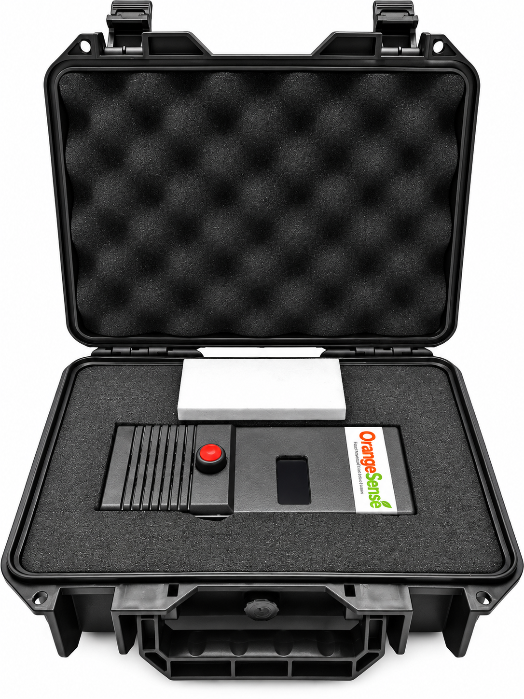
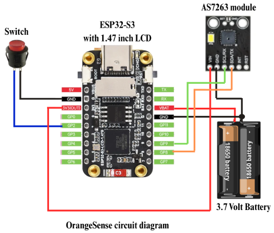

# OrangeSense 🍊

**A low-cost portable VIS/NIR spectroscopic device for non-destructive estimation of orange sweetness (°Brix)**

OrangeSense estimates the sweetness of an orange (°Brix) without cutting or squeezing the fruit. An AS7263 multispectral sensor measures light reflected from the peel at six visible and near-infrared wavelengths. The readings are converted to reflectance and absorbance, and a Multiple Linear Regression (MLR) model running on an ESP32-S3 predicts °Brix in real time. The device works on its own and does not need a computer or internet connection.



---

## Features

- Non-destructive sweetness measurement: the fruit is not damaged
- Real-time °Brix prediction shown on a built-in display
- Low-cost multispectral sensor (AS7263, 6 bands)
- Portable, battery-powered ESP32-S3 platform
- Works offline, with no internet or computer required
- Total prototype cost of about **1,583 THB**

---

## Hardware

| Component | Role |
|---|---|
| ESP32-S3 | Microcontroller that runs the MLR model |
| AS7263 VIS/NIR spectral sensor | Measures reflected light at 610, 680, 730, 760, 810 and 860 nm |
| 1.47" TFT LCD display | Shows the predicted °Brix |
| Push button | Starts a measurement |
| Lithium battery | Portable power supply |



---

## Dataset

| Orange variety | Thai name | Fruits | Train | Test |
|---|---|---:|---:|---:|
| Mandarin orange | ส้มแมนดาริน | 100 | 80 | 20 |
| Sai Nam Phueng tangerine | ส้มสายน้ำผึ้ง | 100 | 80 | 20 |
| Khiew Wan tangerine | ส้มเขียวหวาน | 98 | 78 | 20 |
| **Total** | | **298** | **238 (80%)** | **60 (20%)** |

- Oranges were bought from local markets in Phuket, Thailand.
- Each fruit was scanned **10 times** and the readings were averaged.
- Reference sweetness (°Brix) was measured with a **refractometer**.
- The data were split **80:20 into training and test sets within each variety**, so all three varieties appear in both sets.

---

## Methodology

1. **Sample preparation:** collect three orange varieties (298 fruits in total).
2. **Spectral measurement:** measure a white reference panel, then each orange, with the AS7263. Take 10 scans per fruit and average them.
3. **Feature calculation:** for each of the 6 wavelengths λ, compute

   - Reflectance: `R_λ = I_raw / I_ref`
   - Absorbance: `A_λ = log10(1 / R_λ)`

   This gives 12 candidate predictors (6 R + 6 A). The target is the refractometer °Brix.
4. **Data preparation:** check the data in RStudio and split it 80:20 (238 train / 60 test).
5. **Model building:** fit an MLR model on the training set. Use **backward elimination**: drop the variable with the highest p-value (> 0.05) one at a time, until every remaining variable has p ≤ 0.05.
6. **Model evaluation:** evaluate the final model on the 60 test fruits using R² and RMSE.
7. **Deployment:** write the equation into Arduino IDE code on the ESP32-S3, so the device reads the sensor, computes R and A, and displays the °Brix.

---

## Best MLR Model

Backward elimination kept **7 of the 12 variables**:

```
°Brix = 10.866 − 10.844·R610 + 6.556·R680 − 15.701·R760 + 22.888·R810
        − 11.457·A680 − 21.386·A730 + 32.747·A860
```

### Performance

| Dataset | n | R² | RMSE (°Brix) |
|---|---:|---:|---:|
| Training | 238 | 0.836 | 1.22 |
| Test | 60 | 0.792 | 1.30 |

**Test RMSE by variety:**

| Variety | RMSE (°Brix) |
|---|---:|
| Khiew Wan (เขียวหวาน) | 0.84 |
| Mandarin (แมนดาริน) | 1.28 |
| Sai Nam Phueng (สายน้ำผึ้ง) | 1.65 |

---

## Comparison with Other Tools

| Tool | Approx. cost (THB) | Non-destructive |
|---|---:|:---:|
| **OrangeSense** | **1,583** | ✅ |
| AS7265X sensor (sensor only) | 3,890 | ✅ |
| Refractometer | 1,000 – 30,000+ | ❌ (requires juice) |

---

## How to Use

1. Turn on the device and wait for the display to start.
2. Calibrate with the white reference panel.
3. Hold the sensor window flat against the orange peel.
4. Press the button to take a measurement.
5. Read the predicted °Brix on the screen.

---

## Applications

- Fruit quality grading before sale
- Harvest timing support
- Smart and precision agriculture
- Consumer use when choosing sweet oranges
- Educational and research purposes

## Limitations and Future Work

- The model was calibrated on three orange varieties. Other citrus varieties may need recalibration.
- Prediction error is highest for Sai Nam Phueng (RMSE 1.65 °Brix). More samples from this variety could improve accuracy.
- Possible next steps include more samples across seasons and other fruits.

---

## Authors

**OrangeSense Project Team**
Phuket Wittayalai School, Phuket, Thailand

Presented at the 22nd Thailand Young Scientist Festival (TYSF22).
